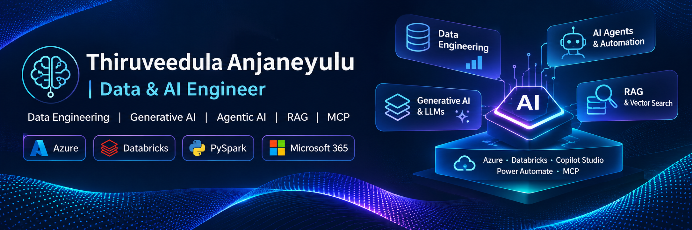

  

# 👋 Hi, I'm Anjaneyulu!

### Data & AI Engineer | Generative AI | Agentic AI | Azure | Databricks

  

I'm a **Data & AI Engineer with 5 years of professional experience**, specializing in building scalable data engineering solutions and exploring intelligent AI-powered applications.

Currently working at Chevron, I work across Data Engineering, Generative AI, and Agentic AI, combining my experience in Azure, Databricks, Python, PySpark, and SQL with modern AI technologies.

🏆 **First Prize Winner – Global Chevron Hackathon**

I'm passionate about building intelligent applications, enterprise AI solutions, and scalable data platforms.

---

## 🚀 About Me

- 💼 5 years of experience in Data Engineering.
- ☁️ Experienced in Microsoft Azure, Azure Databricks, and Azure Data Factory.
- ⚡ Hands-on experience with Python, PySpark, SQL, Apache Spark, and Delta Lake.
- 🧠 Exploring Generative AI, LLMs, RAG, and Agentic AI.
- 🤖 Developed enterprise AI agents using Microsoft 365 Copilot and Copilot Studio.
- 🔍 Worked on enterprise RAG architectures using embeddings, Vector Search, Delta Sync, and reranking.
- 🔗 Explored MCP-based integrations with GitHub and Azure DevOps.
- 🏆 First Prize Winner at a global Chevron organization-wide hackathon.

---

## 🛠️ Technical Skills

### 💻 Programming & Data Engineering

  

- Python
- SQL / T-SQL
- PySpark
- Apache Spark
- ETL / ELT
- Data Warehousing
- Data Modeling

### ☁️ Cloud & Data Platforms

  

- Microsoft Azure
- Azure Data Factory
- Azure Databricks
- Azure Data Lake Storage Gen2
- Azure Synapse Analytics
- Delta Lake
- Unity Catalog
- Azure SQL Database

### 🤖 Generative AI & Agentic AI

- Generative AI
- Large Language Models (LLMs)
- Retrieval-Augmented Generation (RAG)
- Prompt Engineering
- Embeddings
- Semantic Search
- Vector Search
- Document Indexing
- Reranking
- AI Agents
- Model Context Protocol (MCP)
- Databricks Foundation Models
- External LLM APIs

### 🔗 AI & Automation Ecosystem

- Microsoft 365 Copilot
- Microsoft Copilot Studio
- Power Automate
- Databricks Apps
- GitHub MCP Server
- Azure DevOps Integrations

### ⚙️ DevOps & Tools

  

- Git & GitHub
- Azure DevOps
- CI/CD
- YAML
- Ansible

---

## 💡 Professional Experience & Technical Expertise

### 1. Data Engineering

**Technologies:** Azure Databricks | PySpark | SQL | Azure Data Factory | Delta Lake

- Building and maintaining scalable data pipelines.
- Developing data ingestion and transformation workflows.
- Working with distributed data processing using Apache Spark.
- Implementing ETL processes and data integration solutions.
- Working with Delta Lake, data catalogs, and enterprise data platforms.

### 2. Generative AI & Enterprise RAG

**Technologies:** LLMs | Databricks Foundation Models | External LLM APIs | Embeddings | Vector Search | RAG

- Developed AI-powered Databricks applications integrating multiple LLM providers.
- Implemented end-to-end Retrieval-Augmented Generation architectures.
- Worked with document indexing and embedding generation.
- Implemented Databricks Vector Search using Delta Sync indexes.
- Worked with retrieval workflows and reranking.
- Integrated enterprise knowledge sources using GitHub MCP Server and Azure DevOps components.

### 3. Agentic AI & Workflow Automation

**Technologies:** Microsoft 365 Copilot | Copilot Studio | Power Automate

- Developed multiple enterprise AI agents.
- Built AI-driven workflow automation solutions.
- Explored intelligent agent-based applications for enterprise productivity.
- Integrated AI capabilities with business workflows.

### 4. AI Innovation & Recognition

🏆 **First Prize Winner – Chevron Global Hackathon**

Developed an AI-based solution to identify gaps, defects, and outdated versions across 500+ Ansible roles, including version comparisons against relevant Microsoft references.

Recognized with First Prize across the global Chevron organization and awarded a $100 prize voucher.

*Professional experience is described at a high level. No proprietary company source code or confidential information is published here.*

---

## 📚 Areas of Interest & Continuous Learning

- Generative AI and LLM Applications
- Advanced RAG Architectures
- Agentic AI and Multi-Agent Systems
- Model Context Protocol (MCP)
- AI-powered Data Engineering
- Enterprise AI Applications
- Azure AI Services
- Intelligent Workflow Automation
- Cloud-Native Data Platforms

---

## 🏅 Certifications

- Microsoft Certified: Azure AI Fundamentals
- Microsoft Certified: Azure Fundamentals
- Microsoft Azure Databricks for Data Engineering
- HackerRank SQL (Intermediate)
- SQL for Data Science
- Data Warehouse Concepts, Design, and Data Integration

---

## 📊 GitHub Statistics

  
  

  

---

## 🤝 Let's Connect!

  
  

I'm always interested in connecting with people working in Data Engineering, Artificial Intelligence, Generative AI, and emerging technologies.

**Always learning. Always building. Always innovating. 🚀**
